<p align="center">
  
</p>

```yaml
# kubectl describe pod guilherme-messer
metadata:
  labels:
    role: desenvolvedor-backend
    company: south-system
    cloud: aws
  annotations:
    agora: "APIs em Spring Boot e backend Node.js serverless (Lambda + SQS) na South System"
    destaque: "Pipeline que transforma erro 500 em pull request de correção, com Step Functions + Amazon Bedrock (Febraban Tech)"
    projeto: "Silpo (AGES/PUCRS): infra AWS com OpenTofu + Terragrunt e backend FastAPI, nos repositórios fixados abaixo"
```

<p align="center">
  <a href="https://www.linkedin.com/in/guilherme-messer">LinkedIn</a> ·
  <a href="mailto:guilhermemesser@gmail.com">E-mail</a> ·
  <a href="https://www.credly.com/earner/earned/badge/2d4f2203-4720-4e16-b26a-4c43bea0a3f2">Certificação AWS</a> ·
  <a href="https://github.com/silpoages">Silpo</a>
</p>
